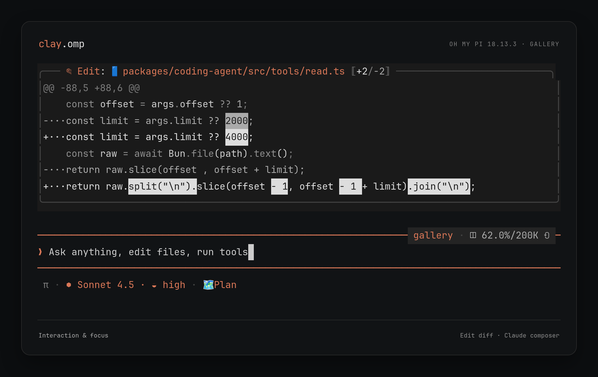
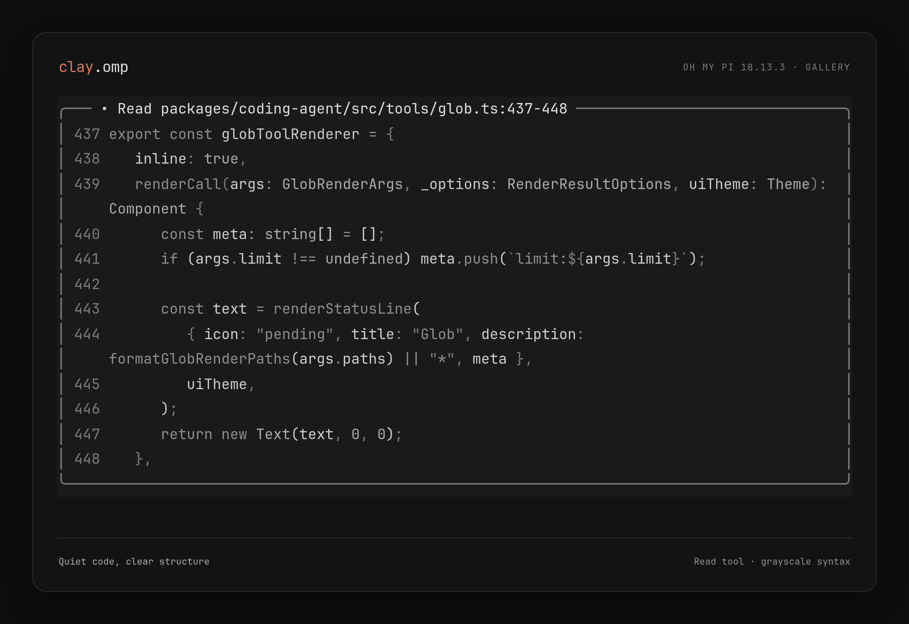

# clay.omp

灰阶为底，一抹陶土色。

[Oh My Pi](https://github.com/can1357/oh-my-pi) 主题，提供暗色 `clay` 与亮色 `clay-light` 两个变体，移植自 [clay.nvim](https://github.com/DefectingCat/clay.nvim)。它只是一份 omp 主题 JSON：不是 Neovim 插件，也不会改动终端配色。



<sub>omp gallery 演示数据，使用更新前的暗色色板，仅示意布局与层级。</sub>

## 设计

- **灰阶为主。** 正文、语法、诊断、Diff 与 Git 状态都靠亮度阶梯区分，而不是红绿。
- **Clay 只做点睛。** `#d97757` 只出现在活动焦点、模型名称与模式提示上。
- **沿用终端画布。** 主背景取终端默认色；消息、工具块与选区才有实色底。
- **亮色是镜像，不是反相。** 两个变体每档文字与底色的对比度一致，亮色中 `bright` 是最深的字。

## 安装

需要支持真彩色的终端，以及支持自定义 JSON 主题的 omp。已在 **omp 18.14.0** 上验证，更早版本未测试。

链接两个主题文件（不加 `-f`，目标已存在时会停下，不会覆盖别的主题）：

```bash
mkdir -p ~/.omp/agent/themes
ln -s "$PWD/themes/clay.json" ~/.omp/agent/themes/clay.json
ln -s "$PWD/themes/clay-light.json" ~/.omp/agent/themes/clay-light.json
```

然后在 omp 中打开 `/settings`，于 **Appearance** 里选择 _Dark Theme → clay_、_Light Theme → clay-light_；或者用命令行设置后重启 omp：

```bash
omp config set theme.dark clay
omp config set theme.light clay-light
```

omp 按终端背景的明暗选择槽位，两个槽互相独立，只用一个变体时只装、只设对应的那个即可。

<details>
<summary>其他安装细节</summary>

- **链接 vs 复制**：链接会实时跟随项目文件，项目所在磁盘需保持挂载。想要独立副本，用 `cp themes/*.json ~/.omp/agent/themes/`，之后需手动同步。
- **Profile**：命名 profile 的目录是 `~/.omp/profiles/<name>/agent/themes/`；默认 profile 设置了 `PI_CODING_AGENT_DIR` 时，则是 `$PI_CODING_AGENT_DIR/themes/`。请按实际使用的 profile 安装与选择。
- **恢复原主题**（换成你原来的主题名）：

  ```bash
  omp config set theme.dark titanium
  omp config set theme.light light
  ```

</details>

## 色板

[`themes/clay.json`](themes/clay.json) 与 [`themes/clay-light.json`](themes/clay-light.json) 是唯一的源文件。两者的 `vars` 保留 clay.nvim 色板的完整键名，`colors` 与 `export` 逐字相同，只有 `name` 和色值不同。色值与语义以 clay.nvim 的 [Clay 设计规范](https://github.com/DefectingCat/clay.nvim/blob/master/design/clay-design-system.md)与 `lua/clay/palette.lua` 为准。

| 色板                      | 暗色                  | 亮色                  | 用途                                     |
| ------------------------- | --------------------- | --------------------- | ---------------------------------------- |
| `bg`                      | `#121212`             | `#f6f6f6`             | HTML 导出画布（终端主画布不强制使用）    |
| `float`                   | `#1a1a1a`             | `#ebebeb`             | 工具块、自定义消息、导出卡片             |
| `cursorline`              | `#1e1e1e`             | `#e5e5e5`             | 用户消息、导出信息块                     |
| `diff_delete`             | `#181818`             | `#eeeeee`             | 失败的工具块                             |
| `statusline`              | `#242424`             | `#dddddd`             | 非透明状态栏                             |
| `selection`               | `#363636`             | `#c6c6c6`             | 选中项                                   |
| `border` / `float_border` | `#2a2a2a` / `#444444` | `#d5d5d5` / `#b5b5b5` | 分隔线、工具框线、引用边框               |
| `bright`                  | `#e6e6e6`             | `#202020`             | 标题、工具标题、错误、Diff 新增、已暂存  |
| `fg`                      | `#cccccc`             | `#333333`             | 正文、变量、成功、路径                   |
| `secondary`               | `#aaaaaa`             | `#4b4b4b`             | 工具输出、类型与数字、警告、工作区有改动 |
| `string`                  | `#b0978e`             | `#665048`             | 字符串、行内代码与代码块                 |
| `muted`                   | `#8e8e8e`             | `#616161`             | 关键字、函数、Diff 删除、未跟踪文件      |
| `comment`                 | `#7a7a7a`             | `#737373`             | 注释、思考文字、Diff 上下文、链接地址    |
| `subtle`                  | `#686868`             | `#868686`             | 标点、运算符、列表符号                   |
| `gutter`                  | `#555555`             | `#9d9d9d`             | 关闭思考时的边框                         |
| `clay`                    | `#d97757`             | `#d97757`             | 活动焦点、模型名称、模式、高档思考边框   |

`sidebar`、`search`、`reference`、`diff_add`、`diff_change`、`shadow` 同样保留在 `vars` 中，便于与上游逐键对照；omp 没有对应的角色槽位，因此不被引用。

### 状态如何区分

| 语义                                | 颜色                                         | 辅助线索       |
| ----------------------------------- | -------------------------------------------- | -------------- |
| 错误                                | `bright`                                     | 图标与文字     |
| 警告                                | `secondary`                                  | 图标与文字     |
| 成功                                | `fg`                                         | 图标与文字     |
| Diff 新增 / 删除 / 上下文           | `bright` / `muted` / `comment`               | `+` / `-` 符号 |
| Git 已暂存 / 有改动 / 未跟踪 / 干净 | `bright` / `secondary` / `muted` / `comment` | 状态文字       |

Markdown 标题用 `bright`，链接用 `secondary`，行内代码与代码块正文用 `string` 暖灰（对应 clay.nvim 的 `@markup.raw`）。代码高亮沿用 clay.nvim 的灰阶语法。所有思考档位、Bash / Python 模式与状态栏字段均已配色；图标、旋转动画与输入框布局保持用户原样。

正文需同时设置 `text` 与 `assistantMessageText`——前者并不控制助手的普通段落。

### 与 clay.nvim 的差异

- **函数**：omp 只有一个 `syntaxFunction`，统一取 `muted`（即 `restrained` 模式下的函数调用色），不复制“定义陶土色、调用灰色”的细分。
- **亮色 Clay**：沿用品牌色 `#d97757`，作为文字对底色的对比度仅 2.9。这是设计规范认可的取舍，所以 Clay 只出现在焦点、模型名称与模式提示上。
- **透明背景**：指主画布沿用终端默认背景，并非窗口透明。`statusLine.transparent` 是独立的 omp 设置，开启后会覆盖本主题的状态栏底色。
- **灰阶语义**：错误、警告与 Diff 刻意不用红绿，需结合图标、标签与增删符号阅读。
- **主题边界**：品牌图标、终端 emoji、会话强调色（`statusLine.sessionAccent`）、扩展自带 ANSI 色等可能绕过主题 token，所以界面里仍会有少量固定的非主题色，例如 Python 图标的 `#3776ab` 与状态栏上下文容量（如 `200K`）的 `#a36f5f`。
- **终端调色板**：omp 18.14.0 支持可选的 `terminal` 字段（前景、背景与 16 色 ANSI）；本主题不设置它，终端配色仍由终端决定。
- **Neovim 专属特性**：斜体注释、Tree-sitter / LSP 定义标记、下划线等无法由 omp 的颜色 JSON 独立配置。

## 自定义

改 `vars` 里的色值，所有引用它的颜色会一起变化。两个变体的 `colors` 与 `export` 应保持逐字一致，明暗只在 `vars` 里区分。主题必须包含 omp 要求的完整字段，不要精简成只含覆盖项的片段。

omp 的交互模式会监听当前自定义主题文件并自动重载；新增文件后，先在设置里选择一次。若加载失败，请看 omp 的错误提示，别把内置回退配色误认成 Clay。自定义主题与内置主题重名时，omp 优先加载内置版本。

## 预览



<sub>**omp 18.13.3 gallery** 的真实 ANSI 输出，经 xterm.js 6.0.0、JetBrainsMono Nerd Font 与 Chromium 以 2× 捕获；仅裁剪分节标题、拼合 Edit 与输入框，并加展示外框，未重绘，不含私人会话或凭据。使用更新前的暗色色板，尚未重新捕获，亦无亮色截图。</sub>

`make preview` 直接运行真实的 `omp gallery`，只需 Bash、Make 与已安装的 omp，不需要 Node / Bun，也不发起模型请求：

```bash
make preview                                          # 暗色，完整 gallery
CLAY_VARIANT=light make preview                       # 亮色
make preview ARGS='--tool edit --width 100'           # 单个工具
make preview ARGS='--tool read --state done --width 92'
make preview ARGS='--composer claude --width 92'      # 输入框布局
make preview ARGS='--surface composer'                # 单个界面分节
```

`CLAY_VARIANT` 取 `dark`（默认，预览 `clay`）或 `light`（预览 `clay-light`），其他值会报错退出。脚本会在临时 agent 目录里只链接所选变体，并把明暗两个槽都设为它，运行结束即删除；不安装主题、不改全局设置、不保存会话、不读取模型凭据。gallery 不绘制主画布，预览亮色请在亮色终端中查看。

若 `omp` 是会联网更新的启动包装器，可显式指定已安装的二进制：

```bash
OMP=/path/to/installed/omp make preview ARGS='--tool edit'
```

预览只是对真实 renderer 的目视检查，不是自动测试：omp 18.14.0 遇到缺字段的主题会回退到内置配色并以 0 退出，不能凭退出码判断加载成功。请确认画面里出现 `#d97757` 与灰阶 Diff，再到真实会话里检查 Markdown 与正文的可读性。

### 已验证

两个变体在 omp 18.14.0 上通过以下检查：66 个必需颜色字段齐全（另含可选的 `assistantMessageText`、`thinkingMax`），变量引用全部有效；完整 gallery 均可运行；捕获的真实 ANSI 中，Clay、正文、字符串与 Diff 增删的颜色符合预期。omp 自身的品牌色、会话强调色与其他独立设置未被改动。

## 来源

色板与设计语义来自 clay.nvim 的 `design/clay-design-system.md`、`lua/clay/palette.lua` 与 `highlights.lua`。本项目维护独立的 JSON 映射，运行时不读取 Neovim 仓库；上游色板变化后，请显式同步两个变体并重新检查预览。
